

  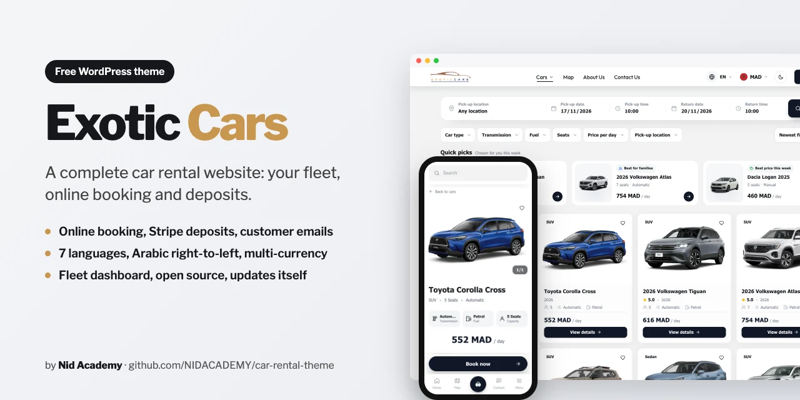

  
  
  
  
  

  
  
  

  <a href="#-download">Download</a> ·
  <a href="#-screenshots">Screenshots</a> ·
  <a href="#-features">Features</a> ·
  <a href="#-need-hosting">Hosting</a> ·
  <a href="#-install">Install</a> ·
  <a href="#-updates">Updates</a> ·
  <a href="#-follow-nid-academy">Follow</a>

---

**Exotic Cars** is a free WordPress theme for car rental agencies that want to take bookings online. You get a fleet manager, prices and long-rental discounts, online booking with card deposits, customer emails, handover records and a dashboard with bookings, income and profit. Visitors can use the site in 7 languages, including Arabic with a full right-to-left layout, and prices switch between currencies automatically.

## ⬇ Download

**[Download exotic-cars.zip](https://github.com/NIDACADEMY/car-rental-theme/releases/latest/download/exotic-cars.zip)** (latest release), then upload it in **Appearance → Themes → Add New → Upload Theme**.

## 🖼 Screenshots

<table>
  <tr>
    <td width="50%">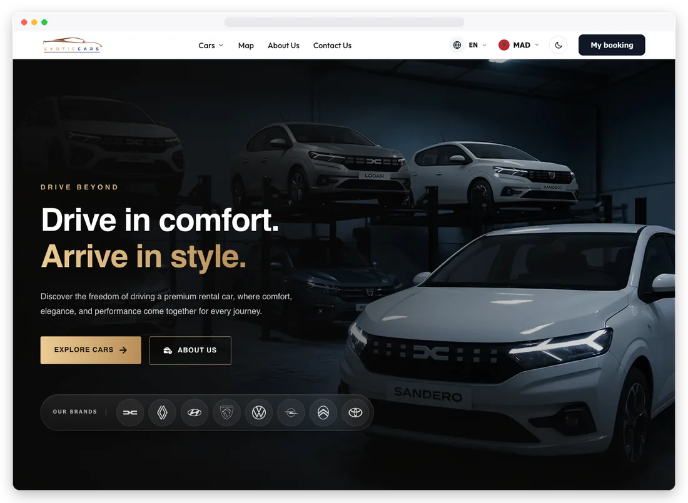 <b>Home</b>: a full-width hero with your brands and two calls to action.</td>
    <td width="50%">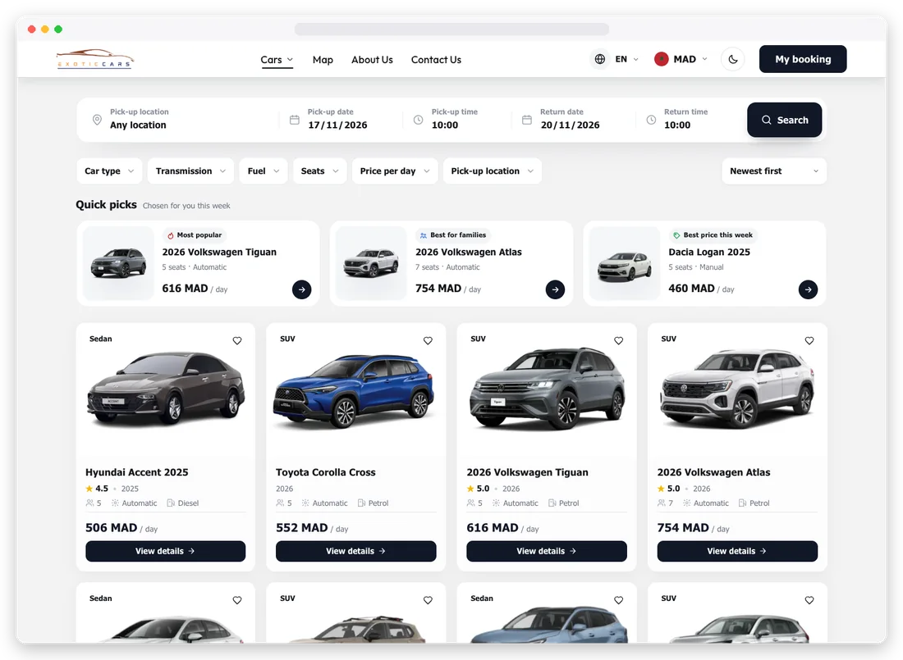 <b>Cars</b>: search by place and dates, filters and quick picks.</td>
  </tr>
  <tr>
    <td>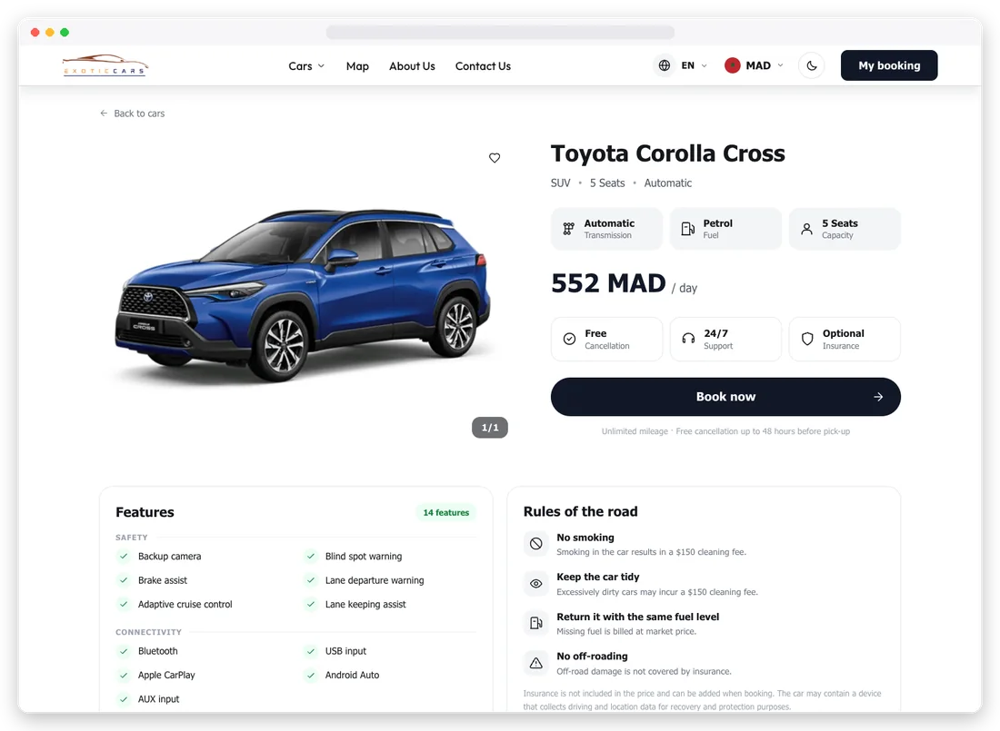 <b>Car page</b>: photos, specs, features, rules of the road and the price per day.</td>
    <td>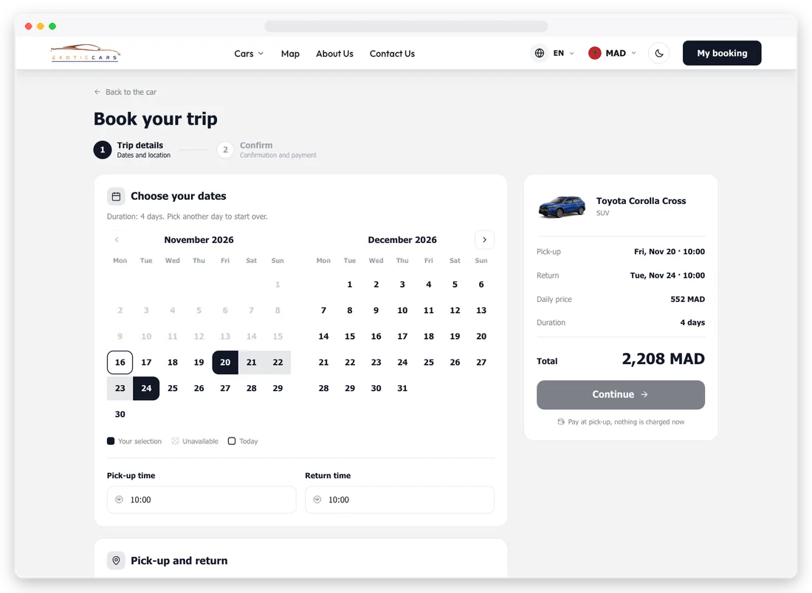 <b>Booking</b>: pick dates on a calendar that hides booked days, with a live total.</td>
  </tr>
  <tr>
    <td>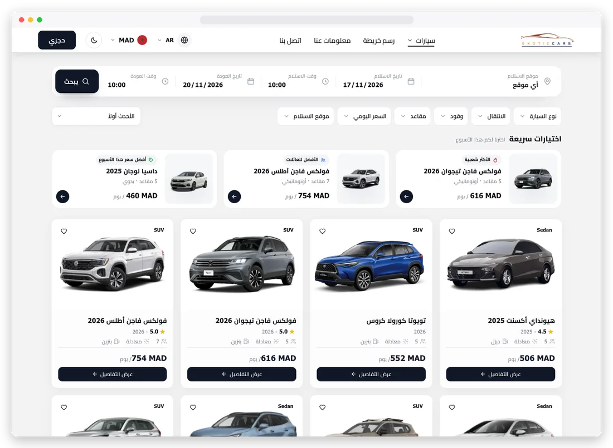 <b>Arabic</b>: the whole site flips right to left, prices switch to the local currency.</td>
    <td>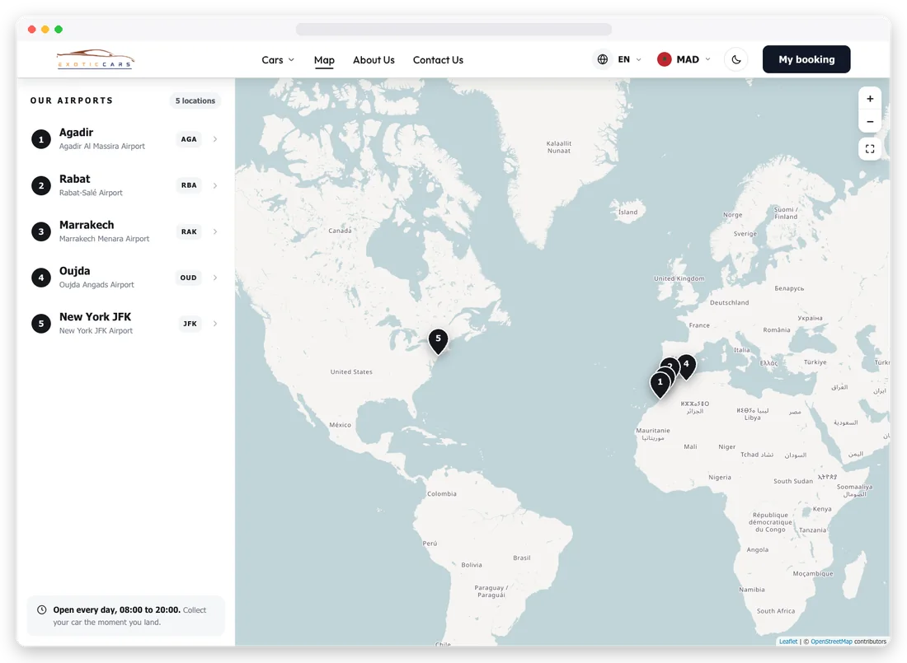 <b>Map</b>: every pick-up location on a map, with directions.</td>
  </tr>
  <tr>
    <td>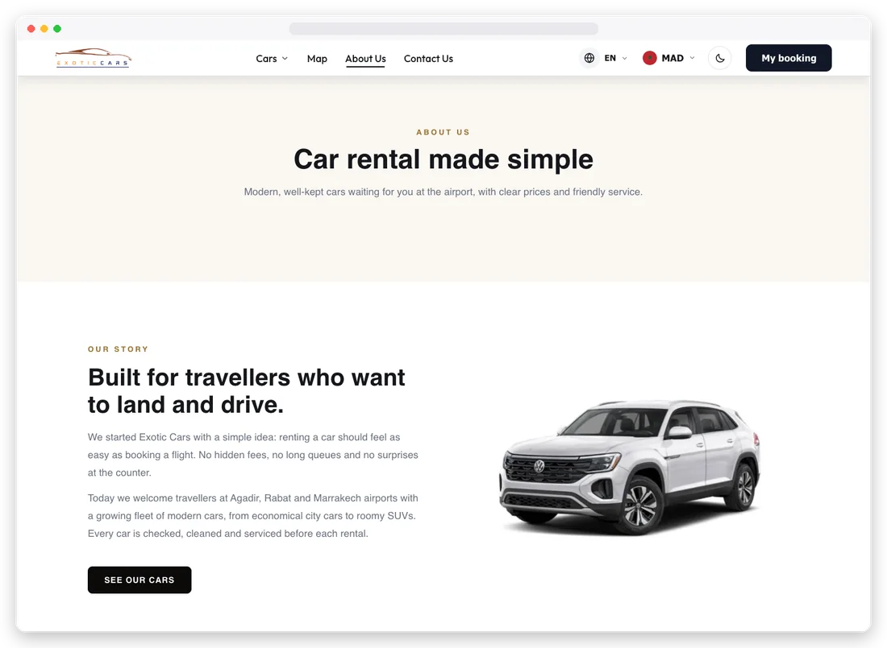 <b>About</b>: ready-made pages you edit with Elementor.</td>
    <td>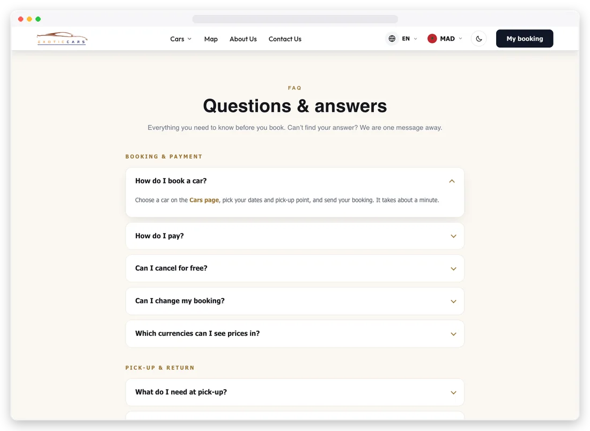 <b>FAQ</b>: questions and answers grouped by topic.</td>
  </tr>
</table>

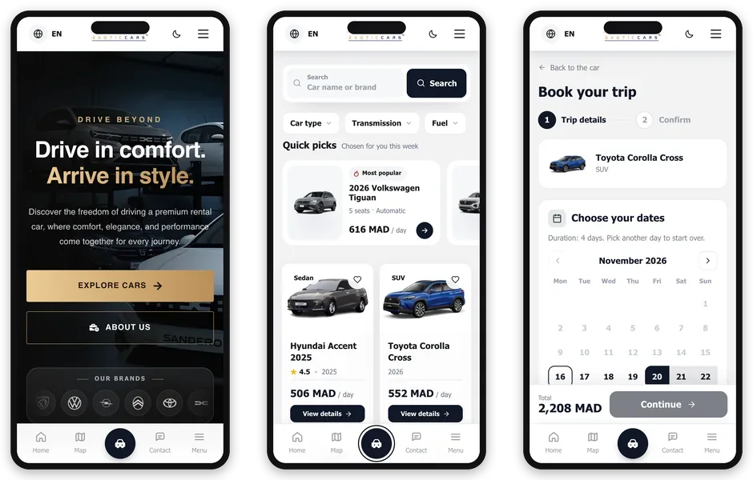 Built for phones: an app-style bottom bar, swipeable car cards and a booking total that stays in view.

## ✨ Features

| | |
|---|---|
| 🚗 **Fleet manager** | Add cars with photos, specs, features, deposit, minimum days and several units of the same model. |
| 📅 **Online booking** | Customers pick dates, times and a pick-up place; booked days are hidden automatically. |
| 💳 **Card deposits** | Take a security deposit with Stripe (your own keys), or let customers pay at pick-up. |
| 💸 **Prices and discounts** | Price per day, weekend days, long-rental discounts and cancellation rules. |
| 📧 **Customer emails** | Booking confirmation, pick-up and return reminders, and a daily summary for you. |
| 📋 **Handover records** | Note fuel, mileage and damage when the car leaves and when it comes back. |
| 📊 **Dashboard** | Bookings, income and profit at a glance. |
| 🌍 **7 languages** | English, Arabic (right to left), French, Spanish, German, Italian and Portuguese. |
| 💱 **Currencies** | Prices switch automatically between the currencies you choose. |
| 🎨 **Customizer** | Header and footer builders, colour themes, car card designs, dark mode and separate desktop / phone settings, all with live preview. |
| 🧩 **Elementor widgets** | Car listings and brand logos you can drop on any page. |
| 🪄 **One-click demo** | Appearance → Import demo installs the demo website in about a minute. |
| 🔄 **Updates itself** | New releases show under Dashboard → Updates. |

## 🌐 Need hosting?

Exotic Cars runs on any WordPress site. No site yet? We use **Hostinger** for our own sites.

<a href="https://www.hostinger.com/nidacademy">
  <picture>
    <source media="(prefers-color-scheme: dark)" srcset=".github/images/hosting-dark.webp">
    <source media="(prefers-color-scheme: light)" srcset=".github/images/hosting-light.webp">
    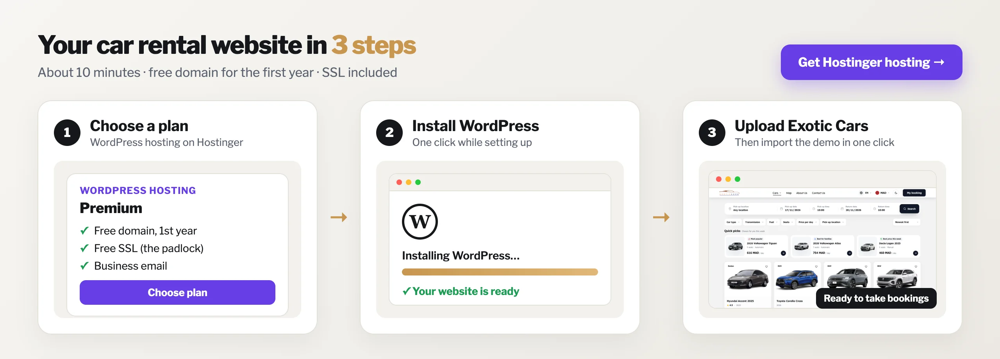
  </picture>
</a>

<b>Show the steps</b> (about 10 minutes)

 

1. **Choose a plan.** Open [Hostinger](https://www.hostinger.com/nidacademy) and pick a **WordPress hosting** plan. *Premium* is enough to start; *Business* adds daily backups.
2. **Create your account and pay.** 12 or 24 months gives the lowest monthly price.
3. **Claim your domain**, for example `yourcarrental.com`, or connect one you already own.
4. **Install WordPress.** When asked what you want to build, choose **WordPress** and skip the suggested theme. Already past this step? In hPanel go to **Websites → Add website → WordPress**.
5. **Log in** at `yourdomain.com/wp-admin` once the domain and SSL are ready (a few minutes).
6. **Install Exotic Cars** with the steps below.

Affiliate link: Nid Academy earns a small commission if you buy through it, at no extra cost to you.

## 🚀 Install

1. [Download `exotic-cars.zip`](https://github.com/NIDACADEMY/car-rental-theme/releases/latest/download/exotic-cars.zip).
2. In WordPress, go to **Appearance → Themes → Add New → Upload Theme**, choose the zip, then **Install Now** and **Activate**.
3. Go to **Appearance → Import demo**, click **Install & activate** next to Elementor and GTranslate, then **Import the demo**.
4. Make it yours:
   - **Site name**: Settings → General → Site Title (used in the header, emails and page descriptions).
   - **Logo, colours, header, footer, welcome and language pages**: Appearance → Customize.
   - **Page texts and photos**: open a page and click **Edit with Elementor**.
   - **Cars, prices, discounts, locations and bookings**: the **Your Cars** menu.
   - **Card deposits**: Your Cars → Online payments (paste your own Stripe keys).

**Requirements:** WordPress 6.4+ and PHP 8.0+. Uses the free **Elementor** and **GTranslate** plugins.

> The demo photos and car brand logos are examples. Replace them with your own photos, and make sure you are allowed to use any brand logo you keep.

## 🔄 Updates

Once installed, new versions appear under **Dashboard → Updates** like any other theme. You can also turn on auto-updates in **Appearance → Themes**. See the [changelog](CHANGELOG.md).

**Customising one site?** Use a small child theme, so updates never overwrite your changes.

## 📣 Follow Nid Academy

Tutorials, tips and new releases:

  
  
  

Found a bug or have an idea? [Open an issue](https://github.com/NIDACADEMY/car-rental-theme/issues).

## 📄 License

GPL-2.0-or-later. See [LICENSE](LICENSE). Bundled fonts: IBM Plex Sans Arabic, Cairo, Assistant and Playfair Display (SIL Open Font License 1.1). Car brand logos are trademarks of their owners.

Made with care by <a href="https://www.nidacademy.org/">Nid Academy</a>

